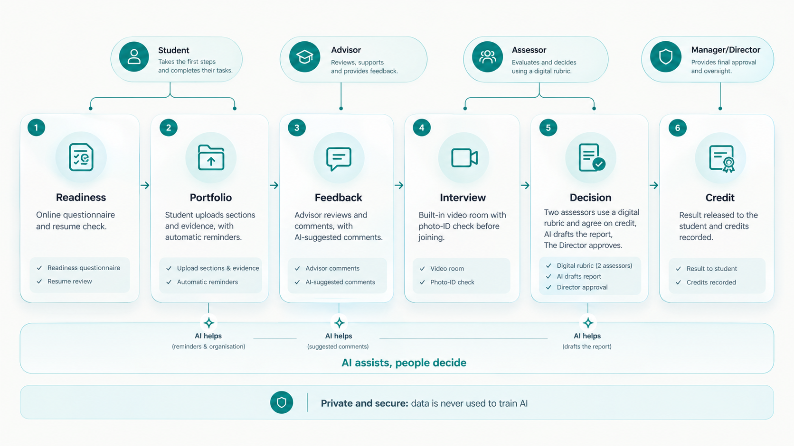

# PLAR Platform: Proposed Features and Capabilities

*A plain-language overview for the PLAR department, advisors, assessors and project sponsors.*

> **Status:** draft v0.2, 2026-10-22. Nothing here is final. Every feature is a proposal to discuss with the PLAR department. Items marked **◆ Needs your input** involve a policy or privacy decision that the department should make first. The [Appendix](#appendix-what-each-feature-builds-on) shows which part of today's process each feature builds on.

---

## What the platform is

**One secure web platform for the whole Competency-based Portfolio journey:**

- a student's first readiness check
- portfolio building and advisor feedback
- assessment and the Discussion of Learning interview
- the final credit decision and the records that follow

Today this journey runs across email, Moodle, Word documents, Outlook calendars and phone or Zoom calls. The platform brings it into one place. **AI handles the repetitive work** (finding, sorting, checking and drafting), so that advisors and assessors can spend their time on what only they can do: judging learning and supporting students.

## How it works at a glance



*The student journey on the platform. Each stage shows who is involved and where AI helps. People make every decision, and student data is never used to train AI.*

## Our commitments

| Commitment | What it means in practice |
|---|---|
| **People decide** | AI never awards credit, rates a competency, or sends feedback on its own. Assessors, advisors, the Manager and the Director make every decision. AI suggestions are clearly labelled and need a person to accept them. |
| **Your data is never used to train AI** | We will only use AI services whose terms guarantee that student information, assessment material and interview recordings are **not used to train the provider's models**. No AI provider has been chosen yet; each option will be checked against this requirement first. |
| **Privacy and security by design** | Access is limited to the people who need it. Data is encrypted. Sensitive items such as ID images are deleted promptly. Every important action is recorded. |
| **Respect for students** | A calm, encouraging experience that reflects PLAR's values, including cultural safety, accessibility and Indigenous ways of knowing. |
| **Accessible to everyone** | Designed to WCAG 2.2 AA, with captions, keyboard access, and audio-only and alternative options. |
| **Consistent and professional** | One design system across the platform and every document it produces. |

---

## 1. One home for every PLAR case

| Feature | What it does | How it helps |
|---|---|---|
| **Student case record** | One page per student: program, credits available, due dates, documents, feedback, interview and result. | No more piecing together a student's status from inboxes and folders. |
| **Journey timeline** | Shows where each student is: readiness check → portfolio → feedback → approval → interview → result → credits recorded. | Everyone sees the same status. Students always know their next step. |
| **Role-based dashboards** | Each person sees their own work: advisors their caseload, assessors their assignments, the Manager and Director their approvals. | Less chasing, and nothing forgotten. |
| **Smart notifications** | Emails and in-app alerts when someone needs to act (for example "Feedback is ready" or "Report awaiting review"). | Fewer follow-up emails, and faster turnaround. |
| **Search and filters** | Find any case by name, T-ID, status, advisor or due date. | Quick answers to "where is this student at?" |

## 2. Getting started: readiness and onboarding

| Feature | What it does | How it helps |
|---|---|---|
| **Online readiness questionnaire** | Students take the 48-question readiness check through a simple link, and their answers are saved to their case. | Advisors see results instantly instead of following up by hand. |
| **Instant readiness feedback** ◆ | After the questionnaire, students get an automatic message about how strong their candidacy is. Advisors have already written this response but it isn't switched on yet. | Students get guidance straight away, and advisors answer fewer routine emails. |
| **Resume intake and review** | Students upload their Autobiographical Resume. Advisors review it next to the Program Plan and the questionnaire results, then record a recommendation. | A clear, tracked decision for every applicant. |
| **Guided onboarding** | Once the fee is paid, students get a welcome page, the handbook and resources, their due date, and an **e-signed Statement of Authenticity**. | A consistent start for every student, with no manual setup emails. |
| **Payment status tracking** | Shows whether the fee has been paid and the student registered (we won't process card payments ourselves). | Advisors know when to open portfolio access. |

## 3. Building the portfolio (for students)

| Feature | What it does | How it helps |
|---|---|---|
| **Portfolio workspace** | Students upload each section (Cover Letter, Resume, Identification of Learning, Demonstration of Learning, Evidence Description and Listing, Evidence) in one organised place. | No more large email attachments or lost versions. |
| **Progress tracker** | Shows which sections are drafted, reviewed and final, with the 24-week timeline. | Students pace themselves. Advisors see who needs a nudge. |
| **Automatic reminders** | Reminders at weeks 6, 12, 20 and 24, adjusted automatically for extensions. | Replaces manual Outlook reminders, and no reminder is ever missed. |
| **Evidence organiser** | Numbers each piece of evidence by competency, links it to its description, and prompts for the "5 Ws". It also warns when the evidence count goes beyond the recommended 16–24 (maximum 30). | Cleaner portfolios, and fewer evidence-related feedback rounds. |
| **Pre-submission self-check** | Before submitting, students see a checklist: page lengths, all 8 competencies present, every piece of evidence described, credit request stated. | Students fix simple issues themselves before an advisor ever looks. |
| **Reflection coach** ◆ | An optional helper that **asks questions** to help students think about what they learned ("What did you do differently next time?"). **It never writes portfolio content.** | Supports the shift from "what I did" to "what I learned", while protecting academic integrity. |
| **Extension requests** | Students request an extension online. When it's approved, the due date and reminders update automatically. | A simple, tracked process. |

## 4. Advisor feedback

| Feature | What it does | How it helps |
|---|---|---|
| **Review and comment in the browser** | Advisors read sections and add comments directly on the document. Students are notified when feedback is ready. | No more download, comment and re-upload cycles. |
| **Smart standard comments** ◆ | When an advisor highlights a passage, the platform suggests the **10 most relevant comments** from the advisors' library of 279 standard responses. The advisor picks one, edits it and inserts it. | Faster, consistent, well-worded feedback. Advisors stay in control of every word. |
| **Automatic checklist checks** | Checks formatting and completeness against the submission checklist automatically. | Advisors spend their time on learning, not on counting pages. |
| **Advisor-only insights** ◆ | Gently highlights, for the advisor only, passages that describe experience without the learning, or examples below the level the student is petitioning for. | Helps advisors find where to coach. |
| **Feedback summary email** | Turns the comments the advisor chose into a draft summary email, which the advisor edits and sends. | Saves writing time on every feedback round. |
| **Caseload view** | All of an advisor's students, sorted by due date and status, with flags for overdue items. | Easier workload planning. |
| **Credit double-check** | Compares the learning a student describes with their Program Plan, to catch courses that have already earned credit ("double dipping"). | Fewer issues at the assessment stage. |
| **Reference verification log** | Records when and by whom a reference letter was verified. | A clear record for assessors. |
| **Ready-for-assessment approval** | The advisor sends a finished portfolio for approval with one click. The approver reviews and approves it in the platform. | A clear hand-off, with no email back-and-forth. |

## 5. Assessment (for assessors)

| Feature | What it does | How it helps |
|---|---|---|
| **Assignment and matching** | The approver assigns two assessors and sets the chair and writer roles. Availability and expertise are shown to help choose a good pair. | Faster, better-informed assignments. |
| **Assessment workspace** | The full portfolio, the evidence and the Program Plan side by side, with nothing to download. | Everything an assessor needs on one screen. |
| **Digital rubric worksheet** | The current Word worksheet becomes an online form. Assessors tick criteria, add notes linked to the exact page, and record their preliminary ratings. Their ratings **stay private until both assessors have submitted**. | Keeps assessors independent, and notes are always saved and organised. |
| **AI evidence map** ◆ | AI points to where in the portfolio each competency criterion seems to be addressed, with links to the exact passages. It highlights gaps and statements that describe experience rather than learning. **It does not give scores.** | Cuts the time spent hunting through long portfolios. Assessors still make every judgement. |
| **Interview question suggestions** | Suggests questions tailored to each portfolio, drawn from the question bank and from gaps in the rubric. Assessors choose and edit. | Interview preparation becomes quicker and more focused. |
| **Shared prep space** | Both assessors see each other's ratings (after submitting their own), with differences highlighted, and agree their final question list. | A more productive pre-interview meeting. |
| **Consensus and credit guide** | After the interview, the assessors record final ratings together. The platform shows the credit range from the Assessment Scale, and the assessors decide the final number and record their reasons. | Consistent, well-documented awards that still rest on the assessors' judgement. |
| **Report drafting** ◆ | Drafts the assessment report from the agreed ratings, the notes and the department's phrase library, following the tone guidelines. The writer edits it, and the chair reviews it in the platform. | Large time savings on every report, with a consistent, caring tone. |
| **Consistency checks** | Checks that the report's narrative, its rating table and the credit award agree before submission. | Fewer reports sent back for correction. |

## 6. Discussion of Learning interviews

| Feature | What it does | How it helps |
|---|---|---|
| **Built-in interview room** (preferred) | A secure video and audio room **inside the platform**. Students join from a link on their case page, with no separate meeting software. Audio-only is available. **Zoom stays available as a fallback** if needed. | Full control of the experience and its security, and the interview connects directly to notes, captions and records. |
| **Interview scheduling** | Collects availability from the assessors, the student and the advisor, suggests times that work for everyone, and sends calendar invitations and reminder letters automatically. | Replaces the monthly availability poll and the email back-and-forth. |
| **Identity verification** ◆ | Before joining, the student shows photo ID to the camera. The platform captures it, checks the image is clear, and uses AI to **help** the advisor confirm the student's identity. **A person confirms the match.** ID images are deleted soon after. Details are below. | Confirms "the student is who they say they are" before the interview starts, securely and with respect. |
| **Device and connection check** | Tests the camera, microphone and connection before the interview, with help if something isn't working. | Fewer dropped or delayed interviews. |
| **Interview companion** | For assessors: the interview script pre-filled with the student's details, the chosen questions, a progress tracker through the 8 competencies, and note-taking for each competency. | A smoother interview, with notes captured as it happens. |
| **Live captions** | Optional captions during the interview. | Accessibility and clarity for everyone. |
| **Recording and transcript** ◆ | With the student's consent, the interview can be recorded and transcribed for the assessors' review and for appeals. | Assessors can revisit answers; the department has a reliable record. |
| **AI note assistant** ◆ | After the interview, drafts a summary of the student's answers for each competency from the transcript. The assessors check and edit it. | Faster post-interview meetings and report writing. |
| **Practice interview** ◆ | Students can rehearse with an AI interviewer before their real Discussion of Learning. It is never assessed. | Less anxiety, and better-prepared students. It builds on the existing mock interview video. |
| **AI-led interview options** ◆ | For discussion only: having AI ask the prepared questions in a structured way, with assessors reviewing the recording and an AI analysis. | A possible future time-saver. It involves significant policy and student-experience questions. |

### How identity verification would work

```
Student opens "Join interview"
  → 1. Consent & privacy notice (what is captured, why, how long it is kept)
  → 2. Camera check
  → 3. Hold photo ID inside the on-screen frame → automatic capture when clear
  → 4. Short live photo of the student's face
  → 5. AI assist: reads the name on the ID, checks it matches the student record,
        checks the ID is legible and not expired, and prepares a side-by-side view
  → 6. The advisor connecting the call reviews the side-by-side and confirms
        (or uses a manual check, e.g. a quick live look at the ID on camera)
  → 7. Student enters the interview room; the chair confirms the student's name as in today's script
  → 8. ID and face images are deleted after the interview (or within a short, agreed window);
        only a verification record is kept (who verified, when, method, outcome)
```

This approach is designed to be safe and fair:

- **A person always makes the call.** AI only reads and compares, and flags anything unclear. A mismatch or a low-quality image is never an automatic failure; it goes to the advisor to check by hand.
- **We collect as little as possible.** The ID number is hidden. Only the minimum is captured. No facial "templates" or biometric profiles are stored.
- **Access is strictly limited.** Only the verifying advisor sees the images, and only during verification. Every view is logged.
- **There are alternatives.** Students who can't or prefer not to use camera verification (for example for accessibility reasons, or with audio-only interviews) can be verified another way the department approves.
- **Which IDs are accepted is the department's decision** ◆, for example government photo ID, a TRU student card or a status card.

This fits today's process. The chair already confirms the student's identity at the start of the interview, and one purpose of the interview is to confirm "that applicants are who they say they are".

## 7. Decisions, records and reporting

| Feature | What it does | How it helps |
|---|---|---|
| **Review and approval workflow** | Reports move from submission → logging → Manager/Director review → final decision. The approver can send a report back with comments. | A clear, timed path for every decision. |
| **Result release** | The approved report and the result are released to the student by email and on their case page. | Faster, consistent communication of results. |
| **Credit recording request** | Prepares a ready-to-send credit-entry request for Records (student, T-ID, program, credits). | No retyping, and fewer errors. |
| **Appeals support** | Gathers the portfolio, ratings, notes, recording (if any) and report for the Director in one place. | Quicker, fairer appeal handling. |
| **Audit trail** | Records who did what and when, including whenever AI suggestions were accepted or edited. | Transparency and accountability for every award. |
| **Retention rules** | Applies the department's rules automatically, for example deleting assessor notes after two years and ID images after verification. | Compliance without manual clean-up. |
| **Insights dashboard** | Volumes, turnaround times, workload, award patterns and bottlenecks. | Evidence for planning and for reporting to leadership. |

## 8. Communication

| Feature | What it does | How it helps |
|---|---|---|
| **Email templates** | Welcome, reminders, feedback ready, interview invitation, the day-before letter, results. Editable by staff. | A consistent, professional voice, and less typing. |
| **Case messages** | Questions and answers between a student and their advisor, stored with the case. | The full conversation history stays in one place. |
| **Branded documents** | Reports, letters and summaries generated as polished PDFs in the platform's design. | A professional, consistent look across all documents. |

## 9. Administration and content

| Feature | What it does | How it helps |
|---|---|---|
| **User and role management** | Add staff and assessors, and set who can approve portfolios, assign assessors and release results. | Permissions match how the department actually works. |
| **Content libraries** | Manage the rubric, question bank, standard comments, phrase library and templates, with version history. | The living documents stay current and shared. |
| **Settings** | Reminder schedules, email wording, retention periods, accepted ID types and AI features (on or off). | The department controls how the platform behaves. |

## 10. Training and support

| Feature | What it does | How it helps |
|---|---|---|
| **New assessor practice mode** | New assessors complete a practice assessment on a sample portfolio in the real workspace and receive feedback. | Supports the department's existing training path (handbooks, shadowing, practice assessment). |
| **Role-based user guides** | Short guides for students, advisors, assessors and administrators. | Easy adoption. |
| **Video walkthroughs** | Short videos showing each role's main tasks. | Training at any time. |
| **In-app help** | Contextual tips and links to the handbooks. | Answers where they're needed. |

## 11. Trust, privacy and security

| Capability | What it means |
|---|---|
| **No training on your data** | Only AI services and settings that contractually exclude our data from model training, and limit how long it is kept. |
| **Data location** | Data stored in Canada wherever possible. AI processing location is confirmed for each option before use. |
| **Secure access** | TRU single sign-on for staff, secure sign-in for students, and per-case permissions (for example, assessors only see their assigned portfolios). |
| **Encryption** | All data encrypted in transit and at rest. |
| **Sensitive-data controls** | Extra protection for ID images and recordings: limited access, short retention, and logged viewing. |
| **AI transparency** | AI content is always labelled, and the department can switch any AI feature on or off. |
| **Consent** | Clear consent for recordings and ID verification, with alternatives available. |
| **Accessibility** | WCAG 2.2 AA, captions, keyboard access, audio-only options and alternative formats. |

---

## Appendix: what each feature builds on

Each feature group starts from how the PLAR department works today, as described in the materials it shared with us.

| Feature group | Today's process it builds on | Department materials |
|---|---|---|
| 1. One home for every case | Student status is tracked across email, Outlook and Moodle | Advisor steps; advisor–student email thread |
| 2. Readiness and onboarding | The online readiness questionnaire (its automatic response is not yet switched on); resumes reviewed by email; Moodle access and welcome emails sent by hand | Advisor steps; PLAR Assessor Handbook |
| 3. Building the portfolio | Portfolio section rules and submission checklist; reminders at weeks 6, 12, 20 and 24 | Submission checklist; Student Handbook |
| 4. Advisor feedback | Comments in Word documents; the standard responses library; the submission checklist | Advisor feedback example; standard responses; submission checklist |
| 5. Assessment | Rubric worksheet, question bank, report template and consensus rules | Assessor steps; rubric and assessor worksheet; question bank; report template; PLAR Assessor Handbook |
| 6. Interviews | Zoom or phone interviews connected by an advisor; the chair confirms the student's identity; the interview checks authenticity | Student Handbook; interview script; PLAR Assessor Handbook |
| 7. Decisions and records | Report review and release, credit entry with Records, appeals, two-year retention of notes | Advisor steps; PLAR Assessor Handbook |
| 8–10. Communication, administration and training | Standard letters, the living question and comment libraries, the assessor training path | PLAR Assessor Handbook; question bank; standard responses |
| 11. Trust, privacy and security | Confidentiality of portfolios, academic integrity, accessibility accommodations | PLAR Assessor Handbook; Student Handbook |
